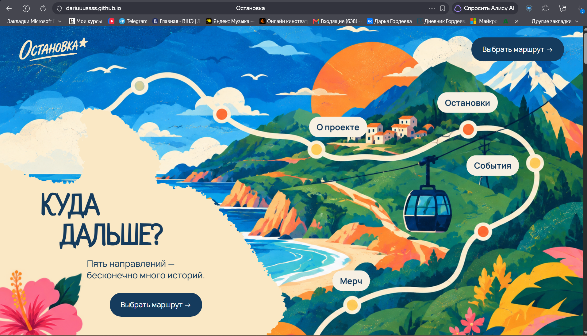

# Остановка

«Остановка» — одностраничный сайт о вымышленном курорте с несколькими направлениями отдыха. Пользователь может выбрать свой маршрут: море, горы, театр, музыку или тишину, а также узнать о проекте, событиях и мерче.

## Ссылка на сайт

https://dariuuussss.github.io/Ostanovka/

## Скриншот

## Автор

Дарья Гордеева, БРИЦП262

## Что я научилась делать

- Разобралась, как собирать одностраничный сайт из отдельных секций и связывать их якорными ссылками.
- Стала увереннее использовать `flex`, отступы, позиционирование и фоновые изображения для переноса макета из Figma в HTML/CSS.
- Научилась подключать локальные шрифты через `@font-face` и добавлять favicon.
- Разобралась, как делать простые hover-эффекты и CSS-анимации без JavaScript.
- Научилась искать ошибки в верстке и постепенно исправлять их, проверяя результат в браузере после каждого изменения.

## Использование ИИ

### Инструменты

Инструмент: ChatGPT 

Для чего использовала: Помощь с HTML/CSS, поиском ошибок, объяснением свойств, CSS-анимациями, favicon, GitHub Pages и частью визуальных материалов проекта 

Уровень помощи: 3

### Записи о запросах

#### Запись №1 · 24.10.2026

- **Что я хотела сделать:** начать верстать одностраничный сайт по своему готовому макету.
- **Что я спросила:** «Помоги мне поэтапно разобраться, как собрать сайт на HTML и CSS по моему макету».
- **Что ответил ИИ:** предложил структуру страницы из секций, базовый HTML-каркас и начальные стили для `body`, фона, шапки и отдельных блоков
- **Что я изменила сама:** использовала свои названия файлов и папок, добавила свои изображения, тексты и цвета, а также переставляла элементы так, чтобы они совпадали с моим макетом
- **Как я поняла, что это работает:** после каждого шага открывала `index.html` в браузере и проверяла расположение блоков

#### Запись №2 · 27.10.2026

- **Что я хотела сделать:** переделать главный экран так, чтобы навигация была встроена прямо в иллюстрацию
- **Что я спросила:** «Сверху в шапке у меня теперь только лого и кнопка "выбрать маршрут", а вместо надписей "море", "театр", "музыка" и т. д. должны быть кнопки навигации»
- **Что ответил ИИ:** предложил убрать обычное меню из шапки и сделать ссылки `О проекте`, `Остановки`, `События`, `Мерч` отдельными элементами поверх фоновой картинки с якорными ссылками на секции
- **Что я изменила сама:** вручную подобрала положение кнопок на своей иллюстрации и позже перестроила главный текст лесенкой: строки заголовка, подзаголовок и кнопку сдвинула относительно друг друга
- **Как я поняла, что это работает:** кликала по каждой ссылке и проверяла, что браузер плавно переходит к нужному блоку

#### Запись №3 · 28.10.2026

- **Что я хотела сделать:** сверстать остальные блоки сайта и приблизить их к макету
- **Что я спросила:** просила написать основной принцип сборки блоков
- **Что ответил ИИ:** дал короткий план по сборке HTML- и CSS-фрагментов для каждого блока и объяснял, какие свойства отвечают за расположение элементов
- **Что я изменила сама:** корректировала размеры и отступы, исправляла классы, меняла структуру под свои готовые изображения
- **Как я поняла, что это работает:** сравнивала план каждого блока с макетом, собирала верстку каждого блока и сразу проверяла изменения в браузере

#### Запись №4 · 29.10.2026

- **Что я хотела сделать:** добавить маршрутные линии и декоративные элементы
- **Что я спросила:** как сделать волнистую линию с цветными точками в блоке остановок и пунктирную линию в истории
- **Что ответил ИИ:** предложил использовать простой SVG `path` внутри HTML и разместить кружки поверх линии через CSS
- **Что я изменила сама:** подбирала положение кружков и линии под свою композицию, потому что первоначальные координаты не совпадали с изображениями
- **Как я поняла, что это работает:** проверила, что точки визуально находятся на линии и не перекрывают карточки

#### Запись №6 · 29–30.10.2026

- **Что я хотела сделать:** подключить favicon
- **Что я спросила:** как добавить иконку во вкладку браузера
- **Что ответил ИИ:** объяснил добавление favicon через `<link rel="icon">`
- **Что я изменила сама:** экспортировала favicon из своего логотипа, исправила его после неудачного экспорта
- **Как я поняла, что это работает:** проверила favicon в браузере

#### Запись №7 · 20–21.10.2026

- **Что я хотела сделать:** подготовить часть иллюстраций и визуальных материалов проекта, сохранив единый стиль
- **Что я спросила:** просила генерировать и упрощать отдельные изображения в палитре проекта, чтобы затем использовать их как референсы или элементы сайта
- **Что ответил ИИ:** помогал создавать и адаптировать изображения под палитру и визуальный язык «Остановки»
- **Что я изменила сама:** часть изображений перерисовала вручную, упростила детали и использовала свои логотипы
- **Как я поняла, что это работает:** сравнила изображения между собой и с макетом, затем использовала подходящие версии в проекте

### Выводы

ИИ больше всего помог мне разбирать верстку по короткому плану и находить причины, почему отдельные элементы в браузере выглядели не так, как в макете. Иногда первый предложенный вариант мне не подходил: например, некоторые линии, отступы или расположение элементов приходилось переделывать и уточнять. Благодаря этому я лучше поняла работу `flex`, позиционирования, якорных ссылок, `hover`, `transition` и простых CSS-анимаций. Сейчас я могу сама менять размеры, отступы, цвета, подключать изображения и шрифты и находить часть ошибок в HTML/CSS без помощи ИИ.
